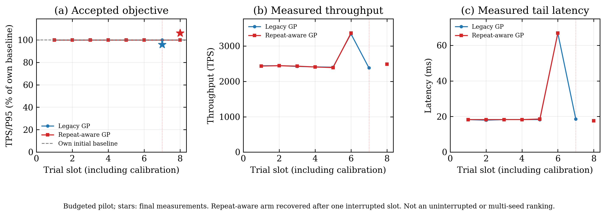

# GP闭环两臂先导与中断恢复记录

报告日期：2026-11-26。原实测源码 `9cd9e46`，计划见[同预算先导协议](COMPOSITE_GP_PAIR_PROTOCOL_20261125.md)。新GP臂发生中断，因此**本次不是完整不中断的严格对照，不用于证明新GP优于旧GP**。

## 1. 实际完成

| 项目 | Legacy-GP臂 | RepeatAware-GP臂 |
|---|---:|---:|
| 有效观测 | 7 | 7 |
| 真实槽位（含中断） | 7 | 8 |
| 初始校准重复 | 3 | 3 |
| 实际API | 4 | 4 |
| 实际tokens | 8877 | 9116 |
| 接受新配置 | 0 | 0 |
| GP选中并实测新候选 | 0 | 0 |
| GP拒绝决策 | 1 | 1 |
| 阶段结束反思 | 成功 | 恢复后成功 |
| 初始配置/数据恢复 | 校验通过 | 校验通过 |

两臂合计14条有效观测、1条中断未知结果、8次API/17993 tokens。上限仍各10槽位、6次API/24000 tokens，没有为了凑满预算重开账本。

Legacy于2026-11-25 22:23:38结束。新GP臂完成6次观测后，第7次最终复测已提交但未写入结果；连接恢复时已无压测、控制器和MySQL进程，不能确定停机原因。新GP臂于2026-11-26 00:28:23开始恢复，00:29:54完成独立收尾。

## 2. 恢复没有伪造数据或重置费用

1. 先完整封存原目录，包括SQLite/WAL、6条有效记录、未提交的7号及3次原API证据。
2. 保留7号为 `interrupted_unknown_result`，TPS、P95、目标值均为null，不从残缺日志重建收益，不进入训练。
3. 验证冻结源码哈希、基准、硬件配额、初始配置和专用实例身份后，在原账本新占8号，仅做独立最终复测，不恢复候选搜索。
4. 原3次API/6228 tokens全部保留；仅新增1次反思/2888 tokens，累计4次/9116 tokens。
5. 恢复后的8号只作独立恢复观测，没有更新中断前GP，最终GP仍训练于原6条有效观测。反思保留中断事实及null值，未修补证据。
6. 原已知活动计时490.92秒，未知中断执行区间按完整试验估计105秒计入账本，恢复阶段约90.57秒。**105秒是估计，不是实测时间；不中断的原25分钟时间边界已经不可完整验证。** API、token和槽位上限未改变。恢复臂不能按原始连续耗时作效率排名。

中断现场归档SHA-256：`3fed81e90a8b0191144374afd13eb9e3f08eb215e6fc63eec81964e222e56efd`。恢复助手源码及哈希随私有最终归档保存。

## 3. 实测终点不是搜索收益

| 臂 | 初始TPS / P95(ms) | 初始目标 | 最终TPS / P95(ms) | 最终目标 | 最终配置 |
|---|---|---:|---|---:|---|
| Legacy | 2439.74 / 18.28 | 133.464989 | 2381.40 / 18.61 | 127.963461 | 原初始配置 |
| RepeatAware（恢复） | 2432.76 / 18.28 | 133.083151 | 2487.79 / 17.63 | 141.111174 | 原初始配置 |

两臂都没有接受新配置。新臂恢复终点较首测高6.03%，不能写成“新ADMTune调优提升6.03%”；这是同一配置、不同时间且发生重启后的观测。旧臂终点较首测低4.12%，也不是配置改变造成的退化证明。

横轴采用真实槽位编号而非连续墙钟，避免把恢复估计和两小时停顿伪装成正常调优时间。星号为最终观测；逻辑接受分数均保持初始100%，吞吐/尾延迟线为各槽位的实测。

## 4. 当前瓶颈比“继续加训练点”更明确

两臂拟合时均有6条有效观测（4条初始配置、两个LLM配置），对剩余6个候选做GP筛选：

| 臂 | 候选数 | LCB通过 | UCB通过 | 同时通过 |
|---|---:|---:|---:|---:|
| Legacy | 6 | 0 | 5 | 0 |
| RepeatAware | 6 | 0 | 5 | 0 |

这是模型对未实测候选的预测，不是这些候选的真实差性能。多数候选仍有较高上界，但全部被下界门槛拦截；没有GP后的新候选审计，尚不能知道是否误拒。

两臂都触发一次有限刷新尝试，但请求前保守token预留加上末端反思保留超过规划额度，因此刷新请求**没有实际发送**。停止原因为 `Tokens reserved for final incremental reflection`，不等于实际24000 tokens已经用完。没有降低记账估计或挪用末端预算强行继续。

当前10槽位中，第5号审计发生在GP拟合之前，第10号又留给最终复测。因此这次小预算先导事实上没有GP后的独立候选审计。**下一步应优先预先安排预算内的GP后候选审计，并精简刷新请求上下文，而非继续反复校准噪声或直接堆100分钟。** 是否调整门槛必须另立协议，不能根据未测候选虚构收益。

Legacy唯一有效前瞻检验是最终同配置复测，误差4.30%且区间漏覆盖；新GP唯一有效检验是重启后的独立复测，误差5.85%且漏覆盖。两者各只有1点，新点又跨越中断，不能作为可靠校准或泛化比较。7号的未知结果不计算误差。

## 5. 科研图包与剩余实验

已核验的数据可以生成静态轨迹、吞吐/延迟权衡、GP预测诊断、先导闭环、实测LLM开销和明确来源的文献参照图，入口见[科研绘图包索引](PLOT_PACKAGE_20261126.md)。

但当前不能声称整套论文实验完成：

- 六方法同协议排名仍缺AgenticDB、AgentTune、GPTuner、CDBTune的真实重跑；
- 多种子独立重复、完整第二基准（例如TPC-H）、新协议动态矩阵和四模块真实消融仍未完成；
- 文献曲线、模拟矩阵、固定配置重复均不能代替这些实验。

本次优先收齐现有数据并导出图表，不再为相同的噪声校准反复调用LLM。完整正式矩阵需要真正补实验，而不是补画数值。

## 6. 留档

- Legacy私有归档SHA-256：`ee7065da12d375779324708d7e8d8923b18ee5b0e752fbb12a5426a5d0393498`。
- 新GP恢复后归档SHA-256：`9253dc2156be301eb77f1d0a16c09110f5c79e9ef915688983db5e17ebe5ee83`。
- 公共数据：`experiment_data/composite_pair_legacy_001`、`composite_pair_repeat_001`、`composite_gp_pair_001`。
- 原始配置及SQLite归档不入Git；公开CSV/JSON、图和报告入Git。既有71次和此前试验没有改写。
