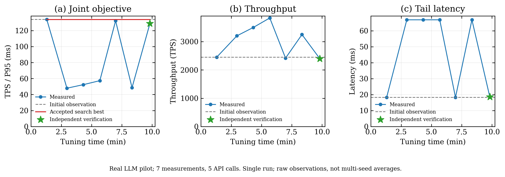

# 综合目标真实闭环第二轮：验收通过，未发现优于初始配置的结果

日期：2026-11-25。运行编号 `composite-pilot-002`，源码 `761ae119bb6683849dcc7463173c0557ceda05a8`。沿用[小预算协议](COMPOSITE_PILOT_PROTOCOL_20261125.md)，使用上轮范围契约修复版本，不覆盖[首轮失败记录](COMPOSITE_PILOT_RESULTS_20261125.md)。

## 1. 核心结论

**真实LLM生成候选、同次TPS/P95评分、GP拒绝与有限刷新、实测接受/恢复、独立复测和增量反思已走通。没有找到综合指标优于初始配置的候选。**

- 7次真实测量全部有效，6个不同完整配置；基线1次、启动探索4次、预先规定的审计1次、末端复测1次。
- 真实 `qwen3.7-plus` 调用5次，共10641 tokens；调优账本活动耗时600.26秒，即10.00分钟。不含部署、测试和冷恢复准备。
- 新账本导入旧观测0条，没有拼接旧71次纯TPS运行、手工诊断或限速实验。
- GP由6条观测首次拟合，参与2次候选拒绝；刷新1次后仍无合格新候选，提前停止搜索。最后以7条有效观测更新模型。
- GP实际选中并执行的新候选为0个；不能把5个启动/审计配置说成GP成功推荐。
- 最后独立复测仍是原初始配置。1次反思提交，数值事实与7条新增证据逐条一致，未自动修补事实数字。
- 数据库配置、并发上下文、四表各200万行和逻辑样本均恢复并复核。没有OS参数修改。

## 2. 实际性能与图

目标为同次测量的 `TPS / P95(ms)`，越大越好。表中保留原始吞吐和P95，分数显示到3位；训练标签保留6位。

| 编号 | 类型 | TPS | P95 (ms) | TPS/P95 | 接受为新父配置 |
|---|---|---:|---:|---:|---|
| 1 | 初始基线 | 2449.99 | 18.28 | 134.026 | 初始值 |
| 2 | 启动探索 | 3203.71 | 66.84 | 47.931 | 否 |
| 3 | 启动探索 | 3500.40 | 66.84 | 52.370 | 否 |
| 4 | 启动探索 | 3835.69 | 66.84 | 57.386 | 否 |
| 5 | 固定审计 | 2417.07 | 18.28 | 132.225 | 否 |
| 6 | 启动探索 | 3249.71 | 66.84 | 48.619 | 否 |
| 7 | 独立复测初始配置 | 2396.99 | 18.61 | 128.801 | 不用于搜索接受 |

最高吞吐候选4相对基线TPS提高56.56%，但P95升高265.65%，综合分数下降57.18%，因此正确地没有被接受。这是本轮目标一致性的重要验收，不应只挑吞吐峰值报告“调优提升”。

末端复测相对首测：TPS下降2.16%、P95升高1.81%、综合分数下降3.90%。**两次是同一配置，不是配置改变造成的退化证明，也不能在单次重复下断言已经量化了稳定噪声分布。** 搜索保留原配置，不等于证明它是全局最优。



蓝线为逐次真实测量，不是单调最优曲线；红线为已接受的搜索最优分数，绿色星号为末端独立复测，灰虚线为首测参考。最后测量约9.82分钟，整个账本10.00分钟包含之后的反思和恢复。

本图只属于本轮静态小预算闭环，不延长到100分钟，不混入其他方法的文献数据，不冒充六方法正式主图。横轴包含本轮调优活动的实际时间，未计入数据准备。

## 3. LLM实际做了什么

| 调用 | 角色 | tokens |
|---|---|---:|
| 1 | 参数选择 | 1467 |
| 2 | 范围裁剪 | 1750 |
| 3 | 第一批候选生成 | 2176 |
| 4 | 拒绝后的候选刷新 | 2659 |
| 5 | 阶段结束增量反思 | 2589 |
| 合计 | 5次真实API | 10641 |

选择的四个参数为缓冲池、两个I/O容量和排序缓冲区；并发参数仍属于完整五参数空间，但本轮未被selector选中，实际全部保持0。不能写成已经搜索了所有五个参数或证明并发参数没有价值。

范围裁剪本轮第一次就通过校验，没有格式重试。第一批8个候选中实测5个，剩余3个经GP全部拒绝；刷新输出经完整配置/硬约束过滤后留下6个新候选，GP也全部拒绝。**这些未执行配置没有真实测量标签，不写入训练集。**

上轮失败消耗4次API/5851 tokens；本轮是新编号、新预算的独立运行。两轮合计9次API/16492 tokens，不能将本轮费用说成项目累计费用，也不猜测人民币单价。第二轮结束后没有启动第三轮付费实验。

## 4. GP训练与预测的真实边界

本轮是静态常量上下文 `[0.0]`，采用完整配置编码的联合Matérn-5/2核。不是已验证动态上下文线性核或完整动态ADMTune创新。

| 模型 | 训练数 | 长度尺度 | 幅度 | 标准化噪声标准差 | 优化方式 |
|---|---:|---:|---:|---:|---|
| 决策前第1版 | 6 | 0.126422 | 0.995843 | 0.000911882 | 对数边际似然优化成功 |
| 末端第2版 | 7 | 0.126422 | 0.995843 | 0.000911882 | 重新拟合，复用超参数 |

第1版负对数边际似然为8.479949。噪声参数在标准化对数目标空间，不是TPS或毫秒；本轮估计到了优化下界。最后第7条同配置复测进入第2版后，没有重新优化超参数，不能宣称噪声已经充分学习。

仅有1个“预测先于观测”的检验点，即末端同配置复测：

- 训练数6，预测综合分数134.025638，实测128.801182；
- 单点绝对百分比误差4.056%，不是新配置上的多样本泛化MAPE；
- 预测的±2倍观测标准差区间为[133.869432, 134.182026]，未覆盖实测值；
- 因而是**1个预测、1次区间漏覆盖**，不能用样本覆盖率0%推断总体覆盖率，也不能忽略这次漏覆盖并宣称模型已校准。

全部GP快照、输入编码、对数评分标签、预测训练ID早于被预测记录、LCB/UCB拒绝条件和逐调用用量均已离线重建核验。两次拒绝的分数下界门槛为120.623140、改善门槛为135.365968，属于筛选规则，不是性能安全保证。

## 5. 为什么目前没有收益

实测显示：本轮2～4 GiB缓冲池候选的P95均为66.84 ms，而1 GiB配置为18.28～18.61 ms；前者容器节流周期占比约98.5%～98.7%。例如候选4容器CPU核当量11.88，MySQL进程约9.17。

**数据库和Sysbench客户端共享容器CPU配额**；不能把容器节流直接等同为MySQL独占12核或99%的墙钟时间阻塞。多参数同时改变，也不能据此单独归因为I/O容量。

当前更合理的判断是：生成方向偏重缓冲池增大和I/O扩张，组合目标并未改善；GP只有6个训练点，且噪声区间偏窄；LCB/UCB筛选可能较保守。本轮没有测量被拒候选，不能证明拒绝完全正确或存在可行更优配置。

反思数值事实已严格校验，但文字假设仍把“有效TPS”和综合分数混用，并对I/O容量、节流作了证据不足的归因。它们只是待验证假设，**不能升级为因果规则、硬约束或“已证明”的调参经验**。此次输出的`adjust_range`也未被假称为已经执行。

## 6. 数据保存、复现与下一步

- 私有完整归档：`runs/archives/composite-pilot-002.tar.gz`，文件44个，SHA-256为 `db009803147e9a120a3afa7af396fca29ef443c5ed42189b2d0c55d3e3ad425c`。
- 公共绘图数据：[`experiment_data/composite_pilot_002`](experiment_data/composite_pilot_002)，包含全部观测、预测及区间、拒绝决策、GP参数、模型角色用量、反思和校验。
- 图片：[`figures/composite_pilot_002.png`](figures/composite_pilot_002.png)；矢量版：[`figures/composite_pilot_002.pdf`](figures/composite_pilot_002.pdf)。
- 实测使用的源码保持冻结，报告与绘图更新不修改既有试验记录。

离线核验与绘图：

```sh
python docs/analysis/verify_composite_pilot.py --run-id composite-pilot-002 --output runs/recheck-composite-pilot-002
python docs/analysis/plot_composite_pilot.py --run-id composite-pilot-002
```

**下一步优先做低成本重复测量与GP不确定性校准，再扩大付费预算。** 预先固定少量参考配置和重复次数，估计同配置波动；在新版本中验证噪声更新及区间覆盖，检查候选多样性与筛选拒绝行为，不靠降低验收阈值或挑选最好种子制造收益。之后才冻结同协议的多种子、动态场景、消融与真实基线矩阵。

当前成果足够作为真实闭环联调图与负结果分析的数据源，尚不足以作为ADMTune优于其他方法的论文主结论。
