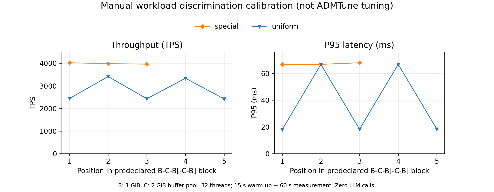

# 负载区分度校准：热点与均匀分布

## 结论

八次真实测量全部有效、零 LLM 调用，最终恢复初始配置。
均匀分布的两组缓冲池候选相对相邻参考的 TPS 收益为 **40.03%、37.59%**，
最大相邻参考漂移为 **0.53%**，通过事先冻结的启动门槛。
热点分布下仍未出现缓冲池收益，旧的无收益结果不删除。

**通过的是 TPS 区分度，不是 ADMTune 算法优势，也不是尾延迟改善。**
均匀分布下，2 GiB 配置的 P95 约 66.84 ms，明显高于 1 GiB 配置的约 18 ms。
后续序列按已声明的 TPS 目标运行，保留 P95；不能据此宣称 TPS/P95 联合目标得到改善。

## 固定条件与原始结果

源码 `ee43c65`，本地和服务器各 187 项回归通过。
MySQL 8.0.36 / Sysbench 1.0.20，四表各 200 万行，32 线程，
种子 42，每次 15 秒预热与 60 秒测量，SQL 为原生 `oltp_read_only.lua`。
开始前实际恢复 v2 冷备；只改变随机分布和缓冲池大小，其余参数、持久性保持不变。
`special` 与 `uniform` 都显式传递给预热和测量命令，不再依赖隐藏默认值。

| 次数 | 分布 | 缓冲池 | TPS | P95 / ms |
|---:|---|---:|---:|---:|
| 1 | special | 1 GiB | 4023.46 | 66.84 |
| 2 | special | 2 GiB | 3982.05 | 66.84 |
| 3 | special | 1 GiB | 3960.54 | 68.05 |
| 4 | uniform | 1 GiB | 2441.78 | 17.95 |
| 5 | uniform | 2 GiB | 3411.63 | 66.84 |
| 6 | uniform | 1 GiB | 2431.10 | 18.28 |
| 7 | uniform | 2 GiB | 3336.18 | 66.84 |
| 8 | uniform | 1 GiB | 2418.21 | 18.28 |

每个候选与其前后参考的均值比较；两个收益均超过
`max(5%, 2×最大参考漂移)`，参考漂移也没有超过预声明的 10% 上限。
校准顺序是 B-C-B / B-C-B-C-B，不是随机化的大样本因果研究。
不能只因为原始数据集较大就假定参数敏感，访问分布与可容纳的工作集同样需要显式控制。

## 图与数据

- [原始汇总 CSV](experiment_data/discrimination_001/metrics.csv)
- [重绘脚本](experiment_data/discrimination_001/plot.py)
- [矢量 PDF](figures/discrimination_001.pdf)

图是手工单参数对照校准，不是 ADMTune 自动搜索曲线。
完整原始日志和恢复证据在服务器与本地各保留一份，归档 SHA-256：
`b7a18ee482376604ea6ee0cc1b0045f43988d33938d5b8c69023d86f771d1059`。
本地已重新核对所有归档成员、原始 Sysbench 日志 TPS/P95、单参数配置、
完整执行与配置恢复状态，并重新计算门槛结果。

## 后续约束

新的 50 次真实序列使用 uniform，重新冷恢复，并与本轮校准完全分开记账。
校准观测不注入 GP 或经验库，不把已测得的 2 GiB 配置直接当作算法推荐答案。
热点分布的先导图保留原协议；新曲线不得混入旧分布记录。
新的实验是静态、可续接的低预算 ADMTune 变体，仍需独立动态实验、消融及真实基线比较。
