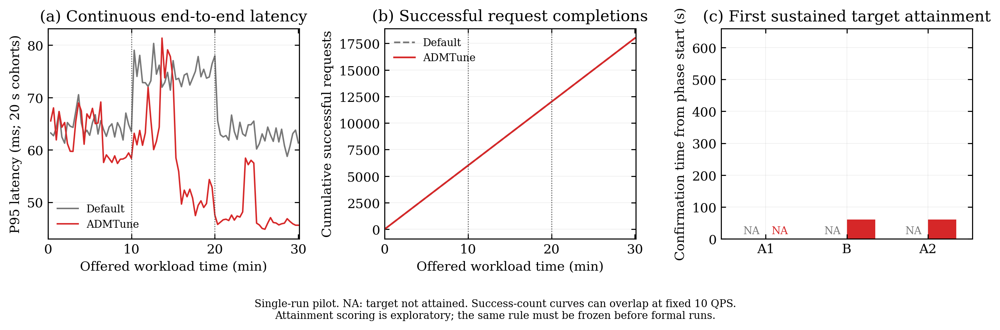

# 阶段1完成：真实动态先导与拒绝审计

## 结论

**当前只证明：在本轮相同只读A→B→A请求计划下，ADMTune相对Default观察到延迟改善，且动态闭环可执行，值得进入四方法首轮。尚未证明优于AgenticDB、AgentTune或OnlineTune，也未单独证明历史复用及四个模块的贡献。**

静态TPS/P95负结果保留不变。本轮是固定10 QPS下端到端P95最小化，不能称为解决了原静态组合指标退化。

## 全过程真实服务结果

各方法持续30分钟、18000条相同请求，分阶段扫描/排序比例9:1→1:9→9:1；包含试验、配置切换、模型推理期间请求，不只挑已接受配置的最好点。

| 范围 | Default P95(ms) | ADMTune P95(ms) | 延迟数值降低 |
|---|---:|---:|---:|
| A1：全部6000请求 | 64.45 | 61.18 | 5.07% |
| B：全部6000请求 | 74.80 | 68.66 | 8.22% |
| A2：全部6000请求 | 63.37 | 46.62 | 26.42% |
| 全程：全部18000请求 | 70.72 | 62.88 | 11.08% |

- 两方法各18000条全部成功，失败、丢弃均为0；固定到达率下累计成功数曲线基本重合，不能声称吞吐优势。
- 累计请求响应时间分别为796.82秒和673.38秒，下降15.49%，仅作为补充指标，不是减少了固定30分钟的运行时长。
- ADMTune真实LLM **12次、15521 token**，没有启发式降级；15条有效配置观测、3次增量反思，GP确实执行过候选选择。
- 稳定阶段确认在8、616、1216秒。三阶段均有有效基准、候选与最终复测，结束恢复初始配置且只读数据完整校验一致。

适应耗时在此先导中采用探索性评分：连续三个完整20秒窗口P95不高于配对Default该阶段窗口P95中位数的90%。A1未达标，B/A2在首组60秒观察中达标；**这不意味着60秒内重新学出了配置，也不能把A2优势直接归因于检索——它也继承了B结束时的较好运行配置。** 正式实验从下一协议开始提前固定此规则，本轮不抵扣正式重复。

## 校准与冷启动处理

最初6次零LLM校准均有效，但扫描基准65.40→46.02 ms，漂移29.63%，未通过20%门槛，因此没有付费启动。原记录完整保留。

随后只新增3次扫描夹测，先做固定180秒中性预热。暖态扫描参考42.81→43.21 ms，漂移0.93%，候选34.77 ms，改善19.15%。原排序三点复用且标明来源：76.93→候选65.25→79.10 ms，改善16.36%、参考漂移2.82%。

原始校准共9次实际测量，不把复用排序记录重复计成新测量。噪声估计0.01466，按预定最小值使用0.02原始对数尺度固定项，进入训练协方差；仅两个重复自由度，不代表普遍可靠校准。两方法均独立启动后执行相同180秒中性预热，才开始30分钟计时。

## 独立GP拒绝候选审计

原运行有7个候选处于完全拒绝批次。按**原预测相对当时最优的乐观改善幅度最大**选一条，不根据审计结果挑候选。模型快照、输入和预测均精确重建。

选中B阶段2 GiB缓冲池、512 KiB排序缓冲候选；参考为当时已验证的2 GiB/8 MiB配置。对相同90%排序请求分布独立执行“参考—被拒候选—参考”，零LLM：

| 左参考P95 | 被拒候选P95 | 右参考P95 | 参考漂移 |
|---:|---:|---:|---:|
| 50.99 ms | 66.95 ms | 51.61 ms | 1.21% |

候选比参考均值更慢约30.51%，没有观察到错过更优配置的信号。它当次未超过原性能准入上限，说明“实测可接受”与“能改善当前最优”不同；不能因此认为放宽GP就会改善效果。

**这是1条抽查，不是全体候选误拒率为0。** 这3次为独立后验诊断，未回填原模型、原预算账本或30分钟曲线。主运行15条＋审计3条共18条配置观测；校准9条另列。

## 下一步与留档

- 已冻结[四方法及消融协议v1](DYNAMIC_MATRIX_PROTOCOL_20261126.md)，先跑请求种子43四方法首轮，检查后补44、45。原生基线保留搜索机制，动态接入方式和共同资源上限均明确记录。
- 本轮不能作为“ADMTune优于其他算法”的论文主结论；需四方法、独立重复及消融完成后再判断。
- [主图、辅助图、PDF及CSV/JSON](experiment_data/dynamic_stage1_20261126/)；[下载图与数据ZIP](exports/admtune_dynamic_stage1_20261126.zip)。
- 原始逐请求、SQLite、全部LLM输入输出、模型快照、冷态失败、暖态来源及审计原件在服务器与本地忽略目录双份保存；公开包不包含密钥。
