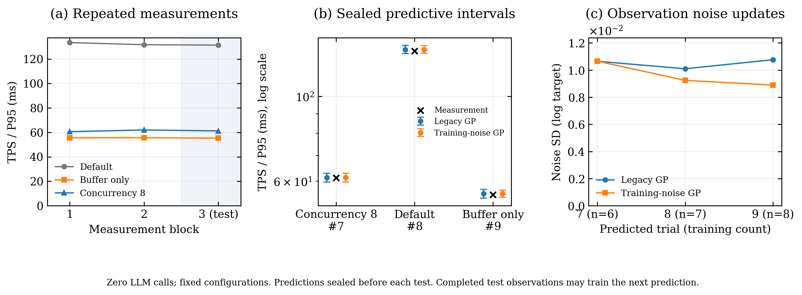

# 新训练噪声策略独立验收：链路通过，优势尚未证明

日期：2026-11-25。实测源码 `927c906`，编号 `gp-noise-validation-001`。按[冻结协议](GP_NOISE_VALIDATION_PROTOCOL_20261125.md)执行，没有使用上一轮三个检验点选择参数或回填新预测。

## 1. 完成情况

- 9次真实测量全部有效，测量阶段729.65秒（12.16分钟），不含源码部署、启动和冷恢复准备。
- **0次LLM调用、0 tokens**；没有新候选搜索，不是付费ADMTune闭环。
- 前6次共同启动数据；第7、8、9次测量之前分别封存两版GP的预测、训练编号和完整模型快照。
- 7号只用1～6号，8号只用1～7号，9号只用1～8号；完成的检验点允许训练下一次预测，不用于改写自身预测。
- 同一批真实测量同时检验两种模型，配置顺序预先固定，不由模型选择。
- 最后恢复初始配置及完整并发上下文；配置哈希、四表各200万行及逻辑样本核验通过。没有修改OS参数、持久性或压测语义。
- 本地和服务器252项回归通过。旧付费控制器未自动切换，新版本仅在显式启用的验收路径运行。

## 2. 预测效果

| 策略 | 顺序检验点 | 平均绝对百分比误差 | ±2观测标准差覆盖 | 平均区间宽度 |
|---|---:|---:|---:|---:|
| Legacy | 3 | 0.5397% | 3/3 | 4.229571 |
| RepeatAware | 3 | 0.5402% | 3/3 | 3.875231 |

**两版均覆盖3点，均值误差几乎相同；新版平均区间窄8.38%。** 这只是本次三点的描述性结果，不是总体覆盖率证明、统计显著优势或调优性能增益。不能选择性省略新版略高的平均误差。

| 编号/配置 | 实测分数 | Legacy预测 | Legacy区间 | 新版预测 | 新版区间 |
|---|---:|---:|---|---:|---|
| 7 / Concurrency8 | 61.208368 | 61.284026 | [59.705963, 62.903799] | 61.284032 | [59.705112, 62.904706] |
| 8 / Default | 131.413020 | 132.567626 | [129.329574, 135.886750] | 132.574904 | [129.607543, 135.610203] |
| 9 / BufferOnly | 55.285672 | 55.626703 | [54.179189, 57.112890] | 55.624400 | [54.425878, 56.849315] |

分数为同次TPS/P95(ms)，训练标签保留6位小数。区间由对数目标预测的±2倍**观测**标准差映射回来，不是TPS单位，也不是潜在函数区间。



图(a)为三个配置的真实重复，阴影为顺序检验区组；图(b)为测量前预测，黑叉为之后实测；图(c)为每次预测时的总观测噪声标准差，使用原始对数目标单位。图(c)从0起点显示变化，没有用截断轴夸大幅度。

## 3. 新更新机制确实在真实运行中执行

| 被预测编号 | 过去训练数 | 重复自由度 | Legacy重优化 | 新版重优化 | 新版固定噪声SD | 新版总噪声SD |
|---|---:|---:|---|---|---:|---:|
| 7 | 6 | 3 | 是 | 是 | 0.010650728 | 0.010656627 |
| 8 | 7 | 4 | 否 | 是 | 0.009235759 | 0.009241872 |
| 9 | 8 | 5 | 否 | 是 | 0.008885712 | 0.008892934 |

表中噪声均为原始对数目标单位。新版本的标准化残余噪声接近优化下界，但固定项已进入训练协方差；不能只看残余项就断言总噪声接近0。快照明确区分固定项、残余项和总噪声。

Legacy总噪声分别为0.010650772、0.010096167、0.010764743。虽然后两次没有重优化，其归一化超参数映射到原始目标单位时仍随目标尺度改变；这不是新的观测噪声估计。

已逐点重建并核验：

- 历史编号、规范标签、完整配置编码、常量上下文与模型输入对应；
- 新版证据指纹、组内自由度和固定噪声与当时过去观测一致；
- 两版快照能重建封存的均值、潜在/观测标准差，固定项确实进入训练协方差；
- 第7、8、9次的封存文件与对应记录相同，提交发生于当前测量之前，未使用当前或未来目标；
- 重新拟合及固定噪声估计没有读取旧纯TPS标签或旧重复实验的检验目标。

## 4. 数据库性能并没有因此变好

这是固定配置GP验收，不是算法搜索。三次边际中位数如下：

| 配置 | TPS | P95（ms） | 逐次TPS/P95的中位数 |
|---|---:|---:|---:|
| Default | 2408.06 | 18.28 | 131.73 |
| BufferOnly | 3782.75 | 68.05 | 55.59 |
| Concurrency8 | 3700.96 | 61.08 | 61.21 |

所有配置均io_capacity=200、max=2000、排序缓冲256 KiB；Default为1 GiB/并发0，其余4 GiB、并发分别0/8。数据仍显示增加吞吐伴随较大尾延迟，不能只取TPS声称新ADMTune获得收益。

本轮32线程、uniform、种子42、原生只读15+60秒、不限速，仍是静态常量上下文。三个检验配置在前6次都出现过，**并未验证未知配置、动态负载或跨环境泛化**。容器CPU含数据库和压测客户端，节流不能单独归因某个MySQL参数。

## 5. 数据与复现

- 私有原始归档：`runs/archives/gp-noise-validation-001.tar.gz`，38个文件，SHA-256 `1098b035580f1a8612f67e171218e4276fdac1048b00faa12d491ac4b36faf7c`，不提交Git。
- 公共绘图数据：[`experiment_data/gp_noise_validation_001`](experiment_data/gp_noise_validation_001)，含9条实测、6条模型预测、逐次参数、封存快照和校验。
- 图：[PNG](figures/gp_noise_validation_001.png)、[PDF](figures/gp_noise_validation_001.pdf)；PDF已渲染检查并修正标签拥挤。
- 模型和测量前提交来自冻结源码；离线核验允许极小跨平台线性代数舍入差异，不修改原始实测值。

```sh
python docs/analysis/verify_gp_noise_validation.py --output runs/recheck-gp-noise-validation-001
python docs/analysis/plot_gp_noise_validation.py
```

## 6. 下一步

这次足够证明“训练噪声、逐批重优化、测量前封存”路径可以真实运行，尚不足以选择新版为性能更好的方法。

下一步应将新策略以**显式选项和新协议指纹**接入综合目标小预算闭环，预先固定校准/复测规则并把它们计入总测量预算，保持与对照相同预算。先验收实际GP筛选、LLM生成、接受/恢复和反思，再扩展多种子与真实方法基线，不直接宣称100分钟主实验已经准备充分。

上一轮固定6/3留出的失败覆盖结果仍保留；不能用本轮不同数据、不同顺序更新方式的3/3，替换它或声称已经普遍修复区间校准。
