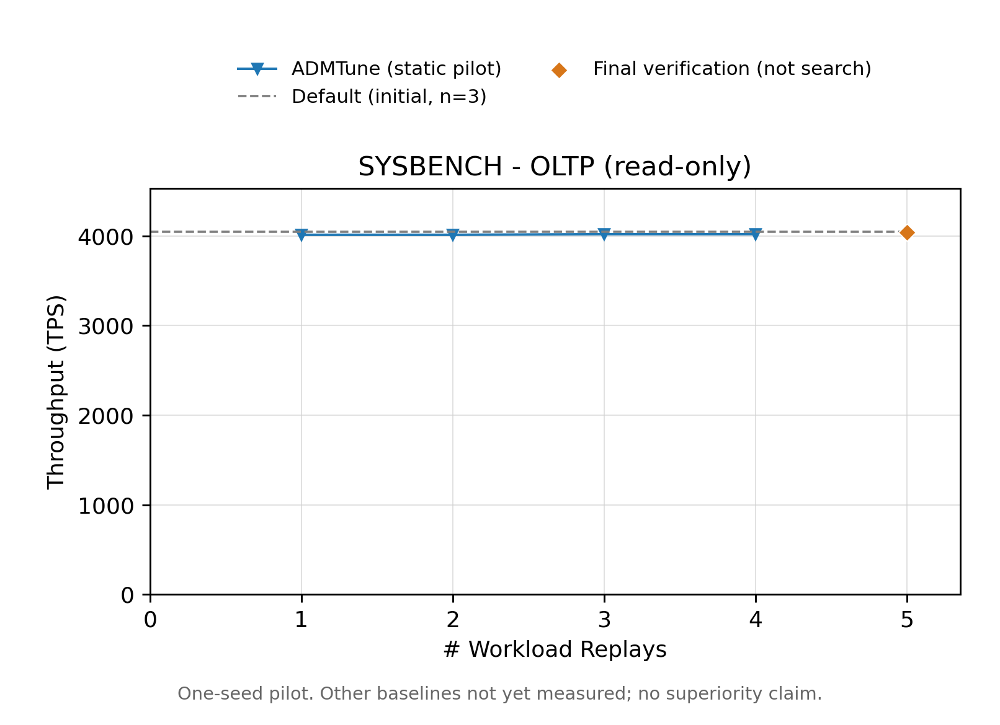

# Default 与 ADMTune 真实静态先导结果

## 一、结论

已生成参考 **AgentTune 图 8** 风格的真实折线图和逐次测量 CSV。
**当前没有发现明确的调优收益，不能把这张图作为 ADMTune 优于其他方法的正式证据。**
GPTuner、AgentTune、CDBTune、MySQLTuner 仅完成源码取得和初步审计，没有实测曲线。

本记录保留无收益结果，不替换数字、不导入论文原图数据、不人为增加上升点。

## 二、运行与环境

- 测量源码：`de4f86c`；本地和服务器各 185 项回归通过。
- 本次是新容器，不拼接此前另一容器的绝对性能数据。
- 实际 CPU：Xeon Silver 4214R；可见 48 核，cgroup 配额为 12 核，内存限额 90 GiB。
- MySQL 8.0.36，独立实例 3308，四张表各 200 万行。
- 原生 Sysbench 1.0.20 `oltp_read_only.lua`，32 线程，15 秒预热 + 60 秒测量。
- Default 和 ADMTune 各自开始前都从同一冷快照恢复，并验证复制字节、行数和样本；原目录保留。
- 四个可调整参数：缓冲池大小、两个 I/O capacity 参数、排序缓冲大小。
- Default 是**实验共同初始配置**，缓冲池为 1 GiB，不能称作未经修改的 MySQL 出厂配置。
- 全程只读，不修改持久性设置；末尾配置哈希、800 万行数量和逻辑样本均复核一致。

原始 UTC 时间：

- Default 测量完成：2026-11-24 16:07:31 UTC。
- ADMTune 测量完成：2026-11-24 16:15:16 UTC，即北京时间 2026-11-25 00:15:16。
- 文件与协议编号沿用 `20261124`，不是把午夜后的北京时间误记为前一天。

## 三、逐次实测

| 方法 | 槽位 | 类型 | TPS | P95 / ms |
|---|---:|---|---:|---:|
| Default | 1 | 初始配置测量 | 4036.87 | 66.84 |
| Default | 2 | 同配置顺序测量 | 4062.69 | 66.84 |
| Default | 3 | 同配置顺序测量 | 4042.65 | 66.84 |
| ADMTune | 1 | 基准 | 4011.63 | 66.84 |
| ADMTune | 2 | 启动候选 | 4002.77 | 66.84 |
| ADMTune | 3 | 启动候选 | 4018.51 | 66.84 |
| ADMTune | 4 | 启动候选 | 4013.24 | 66.84 |
| ADMTune | 5 | 最终独立复测 | 4035.45 | 66.84 |

Default 中位数为 **4042.65 TPS**，三次顺序测量的样本变异系数约 **0.335%**；
这不是跨种子重复，不能据此绘制跨种子置信区间。

ADMTune 的三个启动候选使用了 2 GiB 或 4 GiB 缓冲池，并联合改变 I/O capacity。
最高候选观测 4018.51 TPS，仅比自身基准高约 **0.172%**，未达到预先定义的 1% 接受门限。
因此最终仍复测原始配置。最终 4035.45 TPS 比 Default 中位数低约 **0.178%**，
不支持性能优越性结论；同配置前后差异也不能解释成调参收益。

所有 P95 输出均为 66.84 ms；这仅表示本次 Sysbench 汇总输出相同，不表示每条请求延迟完全一致。

## 四、为什么只用了五个槽位

预算上限为八个真实槽位，但不要求强行用完：

1. 基准和三个启动候选形成四条 GP 训练观测。
2. GP 对剩余三个候选进行了预筛，均未满足准入/改进条件。
3. 控制器保守停止，并使用第五个槽位完成最终复测。

两份 GP 快照已重建验证，最后训练集有四条配置级观测，**不是将所有 SQL 请求当成训练样本**。
没有经 GP 选择后实际执行的新候选预测，因此本轮**没有可报告的前瞻预测误差或覆盖率**。
不能将“快照可重建、筛选路径执行”称为“预测已经准确”。

最终归一化模型超参数：长度尺度约 0.0183、幅度约 0.0183、噪声标准差约 0.1401。
幅度和长度尺度接近边界、训练点又很少，仍需独立校准，不能据此认定模型可靠。

## 五、LLM 是否真正调用

实际调用四次：选择参数、裁剪范围、生成一批候选、阶段末反思。

- 输入 3114 tokens，输出 1108 tokens，合计 **4222 tokens**。
- 一条反思已通过证据校验。
- 调优账本耗时约 414.27 秒；包含预检和最终恢复的结束时刻另存原始记录。
- Default 不调用 LLM。

## 六、图的含义



图例和线型参考 AgentTune 图 8，但不复制其数值：

- 横轴为实际执行的 workload replay 数，不把五次试验拉伸为一百次。
- 蓝色细折线/倒三角表示搜索过程中已测得的最佳 TPS。
- 最高“已观测候选”与控制器超过 1% 门限后接受的 incumbent 是不同概念：
  图中允许显示 4018.51 的观测最大值，但最终接受配置仍是初始配置。
- 灰色虚线为共同初始配置三次测量的中位数，非其余时刻新增测量。
  CSV 中 Default 的 `best_tps` 是通用导出的累计观测最大值，**不是**主图默认参考线；
  主图按三次原始 `tps` 的中位数 4042.65 绘制。
- 橙色菱形为独立复测，不回填搜索最优值。
- 主图 TPS 轴从零开始，避免把不到 1% 的波动夸大成显著收益。
- 另有局部放大的时间/试验次数/P95 诊断图，仅用于看波动。

文件：

- [逐测量数据](experiment_data/paper_pilot_001/all_measurements.csv)
- [各方法状态](experiment_data/paper_pilot_001/method_status.csv)
- [主图 PDF](figures/paper_pilot_001.pdf)
- [诊断图](figures/paper_pilot_001_diagnostics.png)

完整原始档案已留在服务器及本地忽略目录，包括测量日志、JSONL、GP 快照、调用与反思审计。
归档 SHA-256：
`bdd1e207f86654a68065f8ff5a4d7f9ed07cf8c87a5cf239c8b159420599fe30`。
本地重新校验归档成员、原始日志 TPS/P95、曲线计算、模型训练输入、用量合计及环境一致性后才绘图。
Git 只提交小型汇总 CSV、图、代码与中文记录，不提交密钥、私有连接配置、物理数据库和大日志。

## 七、原因分析与下一步

服务器 `sysbench --help` 显示默认 `rand-type=special`，默认特殊值比例 1%、访问比例 75%。
结合 1–4 GiB 候选几乎没有区分度，**热点工作集已能容纳、当前空间对该负载不敏感**是一个合理解释，
但目前不是经过独立对照确认的因果结论，也不能只归咎于 GP。

最优先的下一步不是直接放大付费矩阵，而是：

1. 显式记录并固定随机分布，做零 LLM 的 uniform 与热点负载、1 GiB/2 GiB 配置交错对照；
   不改写本轮 special 分布结果，也不事后混进同一协议。
2. 根据独立校准检查参数区分度、噪声和 GP 不确定性，再冻结正式空间与预算；
   不以挑选 ADMTune 成绩最好看的协议为目的。
3. 接通 AgentTune 原树搜索、GPTuner 原 coarse-to-fine BO 和 MySQLTuner 建议执行规则；
   CDBTune 需完成 Python/PyTorch 迁移及实际训练更新验证，不能用未训练随机动作冒充。
4. 全方法同协议、独立种子重复后再生成正式整体性能比较；动态变化和四项消融另行执行。

当前图是**真实先导图和绘图数据源**，不是完整六方法论文主结果。

## 八、重绘

本地绘图使用 Matplotlib 3.9.4、Contourpy 1.3.2、NumPy 1.26.4、SciPy 1.13.1；
PNG 与矢量 PDF 已检查，无文字或标记裁切。

本地采集目录重绘示例（输出目录必须尚不存在）：

```bash
ROOT_DATA=runs/collected-paper-pilot-12972-001/runs
python -m admtune.paper_plot \
  --default-run "$ROOT_DATA/paper-default-001" \
  --admtune-run "$ROOT_DATA/paper-admtune-001" \
  --output runs/figures/new-paper-pilot
```

服务器的原始运行目录直接位于 `runs` 下，重绘时将 `ROOT_DATA` 改为 `runs`。
绘图前检查 manifest、完成/恢复状态及原始文件校验和；缺失的方法不会自动补零或生成模拟曲线。
