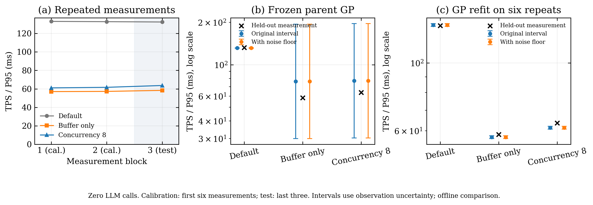

# 零LLM重复与GP区间校准：均值误差改善，但区间仍不可靠

日期：2026-11-25。运行编号 `uncertainty-repeat-001`，实测源码 `a5f5330`；配置、顺序、时间切分和四种比较设置在[预先协议](UNCERTAINTY_REPEAT_PROTOCOL_20261125.md)中冻结。本轮没有候选搜索、额外LLM调用或在线GP修改。

## 1. 完成与恢复

- 9次真实测量全部有效，耗时729.30秒（12.16分钟），0次API、0 tokens。断线期间后台完成，重连后核实成功退出及完整归档。
- 三个固定配置、三个位置平衡区组：D/B/C、B/C/D、C/D/B，不是三个独立随机种子。
- MySQL 8.0.36、四表各200万行、32线程、uniform、种子42，15秒预热+60秒正式测量，不限请求速率。
- 开始前冷恢复一次；每次恢复共同初始配置及并发上下文，不每次清空缓存。配置、行数、逻辑样本及原生压测日志核验通过，没有执行OS调优。
- 运行结束时恢复校验通过；随后重连检查时MySQL未运行。本轮离线分析不需要重启数据库，也未推断停机原因。
- 原始归档40个文件已双端保存，逐文件哈希核验通过。未因断线另起一轮重复测量。

## 2. 原始重复结果

三个配置均为io_capacity=200、max=2000、排序缓冲256 KiB。Default为缓冲池1 GiB/并发0；BufferOnly为4 GiB/并发0；Concurrency8为4 GiB/并发8。

| 配置 | 第1区组TPS/P95 | 第2区组TPS/P95 | 第3区组TPS/P95 | 三次分数样本CV |
|---|---:|---:|---:|---:|
| Default | 132.995077 | 132.691466 | 132.342998 | 0.246% |
| BufferOnly | 57.085577 | 57.305805 | 58.398115 | 1.220% |
| Concurrency8 | 61.107400 | 61.701375 | 63.681947 | 2.169% |

这里的分数均为同一次测量的TPS/P95(ms)，不是吞吐；CV仅描述各配置全部三次的样本离散程度，**没有用于拟合或设定噪声地板**。原始TPS、P95、配置、CPU及节流数据都保留在CSV中。

三次边际中位数分别为Default 2425.60 TPS/18.28 ms、BufferOnly 3830.32 TPS/66.84 ms、Concurrency8 3768.72 TPS/61.08 ms。综合分数中位数132.69、57.31、61.70，均按逐次分数取中位数。

BufferOnly和Concurrency8在第三个区组的分数均高于前两次，Default小幅下降。**只能说存在跨时间变化，不能凭三次观测确定是缓存、CPU争用、环境漂移或单独参数的因果作用。**

## 3. 校准与检验切分

- 校准：编号1～6，每配置两次。
- 检验：编号7～9，依次为Concurrency8、Default、BufferOnly。
- 重新拟合GP及合并组内方差只读1～6号目标；7～9号没有参与拟合、区间阈值选择或模型版本选择。
- 本轮执行器没有在线提交预测；所有比较都是完成后严格按时间切分离线重建，不冒充实时前瞻预测。

比较的四种设置：

1. **Frozen7**：上一轮综合目标闭环最后的7观测GP，训练集及超参数冻结。
2. **Frozen7+floor**：均值、核和后验不变，仅给观测预测方差加入本轮校准估计的噪声下限。
3. **Refit6**：同核、同编码、固定种子42，只用本轮前6次重新优化和拟合。
4. **Refit6+floor**：相同Refit6均值及后验，仅调整观测预测方差。

## 4. 留出检验结果：不能只看覆盖率

| 设置 | 检验点数 | 平均绝对百分比误差 | ±2观测标准差覆盖 | 平均区间宽度 |
|---|---:|---:|---:|---:|
| Frozen7 | 3 | 17.366% | 2/3 | 109.765 |
| Frozen7+floor | 3 | 17.366% | 3/3 | 110.444 |
| Refit6 | 3 | 2.003% | 1/3 | 1.787 |
| Refit6+floor | 3 | 2.003% | 1/3 | 1.787 |

区间宽度的单位是综合分数，不是TPS或毫秒。仅3个检验点，不能由3/3断言总体95%覆盖，也不能由1/3推断总体覆盖率。



图(a)阴影为留出区组；图(b)(c)黑叉为实测，蓝色为原观测区间，橙色为噪声地板区间。后两图使用对数纵轴，误差条为对数预测空间±2倍观测标准差映射回原分数。

### Frozen7：两个宽区间并不代表准确

- Concurrency8实际63.681947，预测76.956909，误差20.846%；原区间约[30.280, 195.589]，虽然覆盖但非常宽。
- BufferOnly实际58.398115，预测76.226433，误差30.529%；原区间约[29.996, 193.707]，同样宽。
- Default实际132.342998，预测131.387450，误差仅0.722%，但原区间[131.250052, 131.524992]没有覆盖。
- 加地板后Default区间扩大为[130.246179, 132.538722]，覆盖实测；两个宽区间基本不变。

因此，3/3覆盖并不等于均值好、区间紧或模型可靠。冻结模型并未在本轮BufferOnly和Concurrency8这两个完整配置上训练，不能把宽区间解释成成功掌握了这些组合的性能规律。

### Refit6：均值更接近，但仍漏覆盖

| 检验配置 | 实测分数 | 预测分数 | 原观测区间 | 是否覆盖 |
|---|---:|---:|---|---|
| Concurrency8 | 63.681947 | 61.404602 | [60.753562, 62.062618] | 否 |
| Default | 132.342998 | 132.838537 | [131.430122, 134.262045] | 是 |
| BufferOnly | 58.398115 | 57.196718 | [56.590292, 57.809642] | 否 |

平均误差降到2.003%，但本轮重拟合训练集也换成了这三个配置的重复观测；**不能把改善全部归因于超参数重优化，更不能当成新配置泛化能力证明。** 三个检验点都属于校准阶段见过的配置，检验的是后续时间上的重复值。

## 5. 噪声为什么没有“一加就解决”

前6次规范对数分数的合并组内残差平方和为0.000056810468，3个自由度；方差为0.000018936823，标准差为**0.004351646**。它没有使用三个检验点。

| 模型/估计 | 噪声标准差所在空间 | 数值 |
|---|---|---:|
| Frozen7原噪声 | 原始对数目标 | 0.000427063 |
| 校准合并估计 | 原始对数目标 | 0.004351646 |
| Refit6拟合噪声 | 原始对数目标 | 约0.004351587 |

Frozen7原噪声明显低于本轮组内估计。Refit6已经从重复观测中学到了几乎同样的噪声，因此再加该地板几乎不改变区间；第三个区组两个配置的分数上移仍超出了区间。三自由度估计、不同配置波动幅度不同、跨时间变化均可能影响区间表现，目前不能确定唯一原因。

Refit6标准化空间超参数为长度尺度0.061442、幅度0.999946、噪声标准差0.011403，目标对数标准差0.381631；边际似然优化成功。**标准化噪声不能直接和上表原始对数单位混比。**

本轮“地板”只改观测预测方差，**没有改GP训练协方差、潜在函数标准差或预测均值**。当前在线LCB/UCB使用潜在函数标准差，因此这份离线地板实现也不会直接改变在线候选筛选，不能声称已经修复代理拒绝过保守的问题。

## 6. 数据、测试与下一步

- 原始私有归档：`runs/archives/uncertainty-repeat-001.tar.gz`，SHA-256 `6119d1ce90112e48c42869229b42ca82f424faf24b1b16222da4c9e5188c2194`；含40个文件，不提交Git。
- 公共数据：[`experiment_data/uncertainty_repeat_001`](experiment_data/uncertainty_repeat_001)，包含全部观测、6/3标签切分、模型快照、噪声估计、逐点区间、误差及文件校验。
- 图：[PNG](figures/uncertainty_repeat_001.png)、[PDF](figures/uncertainty_repeat_001.pdf)。
- 离线计算工具：`admtune/uncertainty_calibration.py`；验收脚本：`docs/analysis/verify_uncertainty_repeat.py`；没有接入在线执行路径。
- 新增7项离线测试，覆盖组内方差、禁止留出点进入拟合、零差异不虚构噪声、区间不缩窄及均值不变等；本地230项测试通过。

复核和绘图：

```sh
python docs/analysis/verify_uncertainty_repeat.py --output runs/recheck-uncertainty-repeat-001
python docs/analysis/plot_uncertainty_repeat.py
```

**下一步不应直接把地板方案接入在线调优并重跑100分钟。** 应先单独冻结一个新版本，验证重复观测到来时的噪声重估/超参数更新，以及跨时间波动处理；若要设置训练噪声下限，需在训练协方差中实现并检验其对潜在不确定性的影响。新版本应使用新的检验数据，不利用本轮三个检验点反复选参数。

随后再做有界的真实闭环、同协议多种子与基线/消融。当前图适合作为测量稳定性与代理误差诊断图，不是ADMTune整体优于其他方法的主图。
